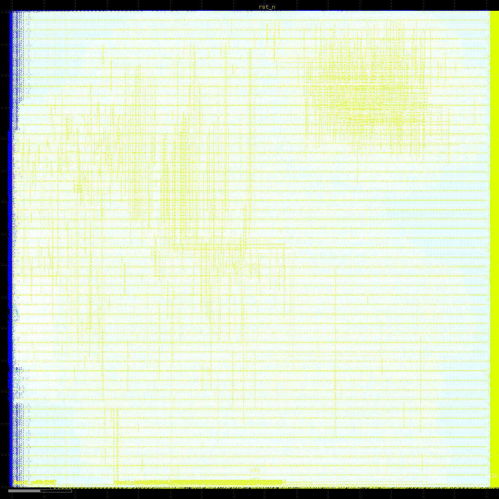

# nano_accel: an INT4 language-model inference chip

nano_accel is a small INT4 LLM-inference accelerator taken from RTL to GDSII
layout with open-source tools (Yosys, Icarus Verilog, OpenROAD-flow-scripts) on
the open Nangate 45nm library. It runs a real character-level language model
trained on tiny-shakespeare.

**Status: verified in simulation and laid out. It has not been fabricated.**
Nothing in this repo shows a tapeout or shuttle submission. The `tt/` variant
is prepared for Tiny Tapeout but is not recorded here as submitted.



## Results

Numbers below come from the author's local `make sim`, `make synth` and
`make pnr` runs. The reports and GDS are generated under `out/` and
`pnr/results/` and are not committed, so rerun the commands to reproduce them.

| | |
|---|---|
| Simulation | **bit-exact, 32/32 tokens**; generated `"tizens:\nWho he we the see the se"` from prompt `"First Ci"` |
| Throughput (sim) | 6,847 cycles/token, **14,604 tok/s @ 100 MHz** |
| Synthesis (Nangate45) | 44,643 standard cells, 0.084 mm² logic, ~0.28 MB SRAM (behavioral, reported separately) |
| Place & route | 183,990 cells, 0.314 mm² design area (56% util) |
| Post-route STA | **setup slack +4.86 ns @ 100 MHz, fmax 194.65 MHz; 0 hold violations** |
| DRC | **0 violations**; KLayout merge clean |
| Power | 143 mW; avg IR drop 1.6 mV |
| GDSII | `pnr/results/nangate45/nano_accel/base/6_final.gds` (generated by `make pnr`) |

At fmax the same design would sustain about 28,400 tok/s.

## What it is

- **Accelerator** (`rtl/`): 64 INT4×INT8 MACs per cycle, a fused dequant/requant
  drain (`y = clamp(round((acc+bias)·M[c]) >> sh)`), a 5-instruction sequencer
  (`SETLEN, GATHER, MATVEC, ARGMAX, HALT`), and on-chip token feedback for
  autoregressive decode.
- **The model it serves** (`sw/build.py`): char-level MLP (context 8, embed 24,
  hidden 512×2, vocab 128), 425,984 params = 208 KiB INT4, trained with numpy
  and post-training quantized (per-channel INT4 weights, INT8 activations). It
  fits fully on-chip.
- **Verification** (`tb/tb_nano.sv`): a numpy golden integer model mirrors the
  RTL numerics, and every generated token is compared.

## Run it

Requirements: `yosys`, `iverilog`, `python3` with `numpy`; Docker for place and route.

```sh
make vectors   # train + quantize the model, emit memory images (out/*.hex)
make sim       # RTL sim: bit-exact check + tokens/s report
make synth     # Yosys synthesis on Nangate45: out/synth_stat.txt
make pnr       # OpenROAD-flow-scripts in Docker: floorplan, route, STA, GDS
```

Try your own prompt or a longer training run:

```sh
make sim PROMPT="To be or" G=48   # your own 8-char prompt, tokens stream live
make sim STEPS=8000               # train ~4x longer: noticeably better prose
```

`G` must be 50 or less (the program RAM holds 256 instructions, 5 per token).

## Repo map

```
rtl/    nano_accel.sv (sequencer + drain), dot64.sv (MAC array), ram.sv (models)
sw/     build.py: train, quantize, compile, golden vectors
tb/     tb_nano.sv: bit-exact check, throughput report
syn/    synth.ys + Nangate45 liberty
pnr/    ORFS config (100 MHz constraint, nangate45); results/ is generated
tt/     Tiny Tapeout variant (see below)
docs/   layout renders (gds_final.png, gds_zoom.png)
out/    generated: hex images, netlist, logs
```

## Experiments

- **Change the model**: edit `V, E, C, H` at the top of `sw/build.py` (keep
  dims multiples of 64), retrain, then run `make synth` for new area and timing.
- **Break the clock**: set 5.0 ns in `pnr/constraint.sdc` and run `make pnr`.
  fmax is 194.65 MHz, so 200 MHz should fail timing and 5.5 ns should pass.
- **Weaken the quantization**: lower the clip bound in `quant_w()` and the
  generated text degrades (still bit-exact, since the golden model degrades too).
- **Waveforms**: add `$dumpvars;` in `tb/tb_nano.sv` and open the VCD in GTKWave.
- **Zoom the layout**: `pnr/dump_png.py` renders the GDS, or open
  `pnr/results/.../6_final.gds` in KLayout.

## Notes

- SRAMs are behavioral (open PDKs ship no SRAM macros). They are blackboxed for
  synthesis and reported separately; the PnR run uses depth-capped flip-flop
  placeholder RAMs plus a real host load interface.
- The model must fit on-chip because INT4 decode reads all weights per token.
  A 2B-param model at 8,700 tok/s would need about 8.7 TB/s, which is
  HBM-class and out of reach at 45 nm. The SRAM-resident case is the realistic
  one (the same one the Kimi K3 blog post used: 0.277 MB SRAM, >8,700 tok/s).

## Tiny Tapeout variant (`tt/`)

A manufacturable port for [Tiny Tapeout](https://tinytapeout.com) (SKY130,
4x2 tiles): all model tensors stream from the 8 MB QSPI PSRAM Pmod instead of
on-chip SRAM. Since the shared 4-bit QSPI bus delivers at most one INT4
weight per SCK, the 64-MAC array collapses to **one MAC + 8 accumulators**
running at line rate, with a bit-serial drain and argmax fused into the head
layer. The PSRAM image (built by `tt/sw/pack.py`) is self-describing — dims,
shifts, prompt, and QSPI sampling latency in a 64-byte header — so the taped-
out chip can run any model that fits in PSRAM.

```sh
make tt-sim    # small model (H=128): pack image, run TT top vs golden — bit-exact
```

Measured in sim @ 47.6 MHz (21 ns), steady state, bit-exact in both cases:
232,121 cycles/token (205 tok/s) for the 28 KiB test model; 1,520,899
cycles/token (31 tok/s) for the full 208 KiB model (vs 14,604 tok/s for the
on-chip original — the price of a 4-bit bus). The first token costs an extra
one-off 10,271 cycles for the power-up wait and header read. Hardened with the
TT LibreLane flow (numbers below as reported by Tiny Tapeout's CI on a pushed
commit): setup and hold met in all 9 corners (worst setup slack +1.78 ns at
max_ss_100C_1v60, worst hold +0.11 ns), 0 routing DRC / 0 magic DRC / 0
antenna violations, 0 LVS errors, 71.9% utilization on 4x2 tiles, 5.2 mW.
Clock floor is 37.4 MHz (PSRAM tCEM); run at 40 MHz or above. To submit, push `tt/`
as its own repo (it mirrors the official `ttsky-verilog-template`) and
enter it at https://app.tinytapeout.com/.
